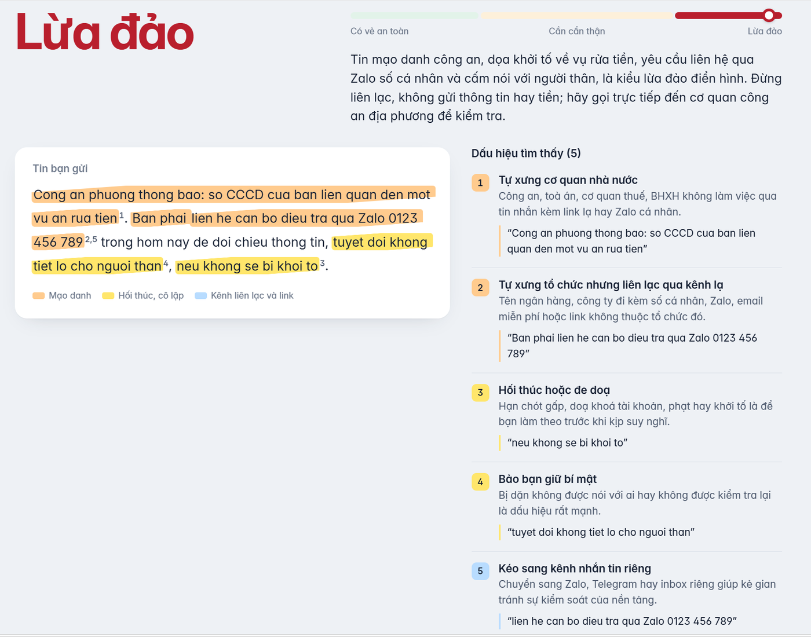

# Soi Tin – phát hiện dấu hiệu lừa đảo trong tin nhắn tiếng Việt

Dán một tin nhắn, email hay bài tuyển dụng nghi ngờ. Soi Tin dùng LLM để kết luận theo 3 mức (*Lừa đảo*, *Cần cẩn thận*, *Có vẻ an toàn*), tô sáng từng chỗ đáng ngờ ngay trong tin, giải thích vì sao và nên làm gì. Dự án nhắm vào các kiểu lừa đảo hay gặp ở sinh viên: việc nhẹ lương cao, làm nhiệm vụ ăn hoa hồng, giả ngân hàng, giả công an, học bổng bắt chứng minh tài chính.



**Điểm chính**

- **Tự xây bộ dữ liệu:** taxonomy 14 dấu hiệu lừa đảo (S01–S14) và 221 tin gán nhãn thủ công (113 lừa đảo, 100 tin thật, 8 không chắc). 84% tin thật là *hard negative*: tin OTP, quảng cáo nhà mạng, thông báo học bổng, tức những tin trông giống lừa đảo nhưng là thật.
- **Đánh giá chặt chẽ:** chia dev/test theo nhóm để các tin cùng chiến dịch không nằm ở cả hai tập; tập test được niêm phong và chỉ chạy đúng một lần cho mỗi model, sau khi đã chốt prompt.
- **Sửa prompt có đo lường:** qua 5 phiên bản (v0 → v4), F1 trên dev tăng từ 81.8 lên 98.9 và tỉ lệ báo nhầm tin thật dễ nhầm giảm từ 51.4% xuống 2.9%.
- **So sánh 4 hệ thống** trên cùng tập test: Claude Haiku 5.5, Claude Sonnet 5.5, Qwen 3.5 9B chạy trên laptop, và baseline luật từ khóa.
- **Web app** (Flask, không dùng CDN): tô sáng bằng chứng theo màu nhóm dấu hiệu, kiểm tra tên miền nhái, soi chữ bị biến dạng để né bộ lọc, chế độ công khai có giới hạn lượt dùng.

## Kết quả trên tập test

128 tin chưa từng dùng khi viết prompt (68 lừa đảo, 60 tin thật, trong đó 49 tin dễ nhầm). Prompt chốt `v4_rules`.

| Hệ thống | F1 (95% CI) | Recall | Precision | Báo nhầm tin dễ nhầm | Đúng dấu hiệu (micro F1) | Chi phí / 1.000 tin | Thời gian / tin |
|---|---|---|---|---|---|---|---|
| Sonnet 5.5 | **97.0** (94–99) | 94.1 | 100.0 | 0.0% | **83.1** | $4.93 | 3.3 s |
| Haiku 5.5 | 94.0 (90–98) | 92.6 | 95.5 | 6.1% | 77.9 | **$0.36** | 2.3 s |
| Qwen 3.5 9B (trên máy) | 91.0 (86–96) | 89.7 | 92.4 | 10.2% | 62.8 | $0 | 8.8 s |
| Luật từ khóa | 61.8 (51–72) | 50.0 | 81.0 | 14.3% | 41.8 | $0 | ≈ 0 |

- Khoảng tin cậy của ba LLM chồng lên nhau ở phần nhãn; Sonnet hơn rõ ở phần chỉ đúng dấu hiệu. Haiku rẻ hơn Sonnet khoảng 14 lần nên là model mặc định trong app.
- Bằng chứng (đoạn trích model đưa ra) có thật trong tin: Haiku và Sonnet 99.6%, Qwen 88.2%.
- Chi tiết từng dấu hiệu, từng loại nguồn: [`results/`](results/).

## English summary

Soi Tin is an LLM-based tool that flags scam signals in Vietnamese messages, emails and job posts aimed at students. I built a 14-signal taxonomy and hand-labeled 221 messages (84% of the legitimate ones are hard negatives such as OTP texts, carrier promos and scholarship notices). Messages were split into dev/test by campaign group, and the test set was sealed: each model was run on it exactly once after the prompt was frozen. Five prompt iterations on dev raised F1 from 81.8 to 98.9 and cut false alarms on hard negatives from 51% to 3%. On the held-out test set (128 messages), Claude Sonnet 5.5 reached F1 97.0, Claude Haiku 5.5 94.0 at $0.36 per 1,000 messages, a local Qwen 3.5 9B 91.0, and a keyword baseline 61.8. The Flask web app highlights the quoted evidence inside the message, checks look-alike domains and flags obfuscated text.

## Cách hoạt động

```
Tin người dùng dán vào
  │
  ├─► Model (Haiku 5.5 / Sonnet 5.5 / Qwen 3.5 9B) + prompt v4_rules + định nghĩa S01–S14
  │     → JSON: label, confidence, signals[{id, evidence}], explanation   (schema/output.schema.json)
  │
  ├─► Kiểm tra link và tên miền        scamdet/links.py + data/official_domains.json
  ├─► Soi chữ bị biến dạng (S14)       scamdet/obfuscation.py
  │
  └─► Hậu xử lý                        scamdet/analyze.py
        gộp mã trùng, tìm vị trí bằng chứng trong tin, chia 3 mức theo confidence
        → giao diện: tô sáng bằng chứng, danh sách dấu hiệu, bảng link, chữ bị biến dạng
```

14 dấu hiệu chia 5 nhóm (mỗi nhóm một màu tô trên giao diện):

| Nhóm | Dấu hiệu |
|---|---|
| Tiền và thông tin cá nhân | S01 đòi chuyển tiền, đóng phí · S07 xin mật khẩu, OTP, giấy tờ · S08 thuê, mua tài khoản |
| Mạo danh | S04 tự xưng cơ quan nhà nước · S05 tự xưng tổ chức qua kênh lạ · S06 giả người quen |
| Mồi nhử | S02 lợi ích bất ngờ, khó tin · S03 làm nhiệm vụ ăn hoa hồng · S13 tuyển dụng không rõ ai tuyển |
| Hối thúc, cô lập | S09 ép thời gian, đe doạ · S10 bảo giữ bí mật |
| Kênh liên lạc và link | S11 kéo sang kênh riêng · S12 link, ứng dụng đáng ngờ · S14 chữ biến dạng để né lọc |

Định nghĩa đầy đủ (gán khi, cụm từ gợi ý, không gán khi): [`data/v1.0/taxonomy.json`](data/v1.0/taxonomy.json).

## Bộ dữ liệu

- Nguồn: bộ `vietnamese_sms_dataset` (CC BY 4.0), ảnh tin lừa đảo được các báo trích làm ví dụ cảnh báo, bài cảnh báo của doanh nghiệp và trường đại học, tin tuyển dụng và thông báo thật từ cổng thông tin hai trường đại học.
- Gán nhãn: `label` theo nguồn xác nhận, `signals` theo nội dung (kể cả tin thật). Thông tin cá nhân được thay bằng tag như `[TEN]`, `[SDT]`, `[STK]`.
- Chia dev 85 / test 128 bằng `scripts/split_dev_test.py` (seed 42): giữ các tin cùng nhóm trong cùng một tập, phân tầng theo nhãn, loại nguồn và từng dấu hiệu.
- **Các tệp tin nhắn (`dev.jsonl`, `test.jsonl`, `unsure.jsonl`) không được công khai**, vì có nội dung chép từ báo và mạng xã hội, một phần dữ liệu chưa rõ giấy phép, và để tập test không lọt vào dữ liệu huấn luyện của các model sau này. Mô tả đầy đủ: [`data/v1.0/DATASET.md`](data/v1.0/DATASET.md).

## Quá trình sửa prompt (tập dev, Haiku 5.5)

| Prompt | Thay đổi | F1 | Báo nhầm tin dễ nhầm | Đúng dấu hiệu |
|---|---|---|---|---|
| Luật từ khóa | baseline | 53.1 | 5.7% | 50.2 |
| v0_baseline | chỉ có tên 14 dấu hiệu | 81.8 | 51.4% | 52.0 |
| v1_full_taxonomy | định nghĩa đầy đủ, có mục "không gán khi" | 82.0 | 37.1% | 66.2 |
| v2_rules | cách quyết định scam/legit, lưu ý từng dấu hiệu, thang confidence | 92.3 | 8.6% | 75.7 |
| v3_rules | tin gửi OTP/tài khoản cho chính người nhận, tên miền nhái, khớp lại taxonomy | 97.8 | 2.9% | 78.2 |
| **v4_rules** | tuyển dụng không rõ chủ kéo sang kênh riêng là lừa đảo, chống lệnh cài trong tin | **98.9** | 2.9% | 79.7 |

Số trên dev lạc quan vì prompt được sửa theo lỗi của dev; số để báo cáo là số trên test ở trên (Haiku 98.9 → 94.0, Sonnet 98.9 → 97.0). Hai lần chạy Haiku cùng prompt trên dev lệch nhau 2/85 nhãn. Các file prompt nằm trong [`prompts/`](prompts/).

## Hạn chế

- **Tuyển dụng giả mạo thương hiệu thật** là điểm yếu nhất: recall trên tin tuyển dụng ở test chỉ 67%. Haiku và Sonnet cùng bỏ sót 3 tin giả danh công ty có thật, trình bày như tin thật.
- **Model không biết tên miền chính thức** của nhiều thương hiệu Việt Nam nên đôi khi báo nhầm quảng cáo thật. App bù bằng danh sách tên miền tự tổng hợp, nhưng danh sách có thể thiếu.
- **Tin thật có giọng giống tin lừa** (ví dụ cơ quan nhà nước nhắc xác thực thuê bao) vẫn có thể bị báo nhầm.
- **Dữ liệu đã ẩn danh**, còn tin người dùng dán vào app thì không; kết quả trên tin thật có thể khác.
- **Tập nhỏ**: 128 tin test, chỉ 11 tin thật thông thường và 6 mẫu S13, nên khoảng tin cậy còn rộng. Mỗi tin chỉ có một người gán nhãn.
- **Lớp hậu xử lý của app** (3 mức, kiểm tra tên miền, soi chữ biến dạng) không có trong số liệu đánh giá ở trên.

## Chạy trên máy

Cần Python 3.10 trở lên và một API key Claude (hoặc Ollama nếu chỉ dùng model trên máy).

```bash
python -m venv .venv
.venv\Scripts\activate              # Windows  (macOS/Linux: source .venv/bin/activate)
pip install -r requirements.txt
copy .env.example .env              # rồi điền ANTHROPIC_API_KEY  (macOS/Linux: cp)

python -m app.main                  # mở http://127.0.0.1:8000
python -m app.main --fake           # thử giao diện, không gọi AI (dùng luật từ khóa)
python -m unittest discover -s tests
```

- Model trong app: **Haiku 5.5** mặc định, **Sonnet 5.5**, và **Qwen trên máy** (chỉ hiện khi Ollama đang chạy và đã `ollama pull qwen3.5:9b`). Prompt trong app là bản đã chốt `v4_rules`, giống hệt lúc đánh giá; model nhận nguyên văn tin.
- **Hậu xử lý ở tầng app:** gộp mã dấu hiệu lặp; tìm vị trí bằng chứng để tô sáng (nguyên văn → bỏ dấu → gần đúng, vì model đôi khi chép lại có sửa chữ); kiểm tra tên miền (thật, .gov.vn, nhái, link rút gọn, kênh nhắn tin, email miễn phí); soi chữ biến dạng bằng luật (trên dev bắt 6/7 tin có S14, không báo nhầm tin nào trong 78 tin còn lại); chia 3 mức theo confidence: ≥ 0.75 *Lừa đảo*, ≤ 0.30 *Có vẻ an toàn*, còn lại *Cần cẩn thận* (ngưỡng chọn theo phân bố confidence trên dev). *Có vẻ an toàn* được nâng lên *Cần cẩn thận* khi tin có tên miền nhái hoặc chữ bị cố tình biến dạng.
- **App không lưu nội dung tin:** không ghi file, không ghi log nội dung.
- `python -m app.main --public`: chế độ đưa lên mạng, chỉ Haiku, giới hạn lượt theo IP và theo ngày (`APP_DAILY_PER_IP`, mặc định 20; `APP_DAILY_TOTAL`, mặc định 300). Nên dùng một API key riêng có giới hạn chi tiêu thấp.

### Chạy lại bài đánh giá

Các script cần bộ dữ liệu (không kèm trong repo):

```bash
python scripts/run_eval.py --model haiku --prompt v4_rules --split dev
python scripts/score.py runs/<ngày>_haiku_v4_rules_dev
python scripts/compare.py --split dev
python scripts/run_eval.py --model haiku --prompt v4_rules --split test --i-am-done-tuning
```

- **Test niêm phong:** `run_eval.py` từ chối chạy test nếu thiếu `--i-am-done-tuning`, và mỗi cặp model + prompt chỉ có một lượt test. Báo cáo của test không in nội dung tin.
- **Model không được thấy** nhãn, dấu hiệu, nguồn, ghi chú gán nhãn, và mặc định cũng không thấy loại nguồn (trong v1.0 mọi mẫu chat/email đều là lừa đảo, đó là đường tắt).
- **Đầu ra lỗi bị tính là sai:** thiếu dự đoán, lỗi API hay JSON sai schema đều tính là sai nhãn và không có dấu hiệu.
- **Dấu hiệu chấm trên mọi mẫu**, cả tin thật. Macro F1 bỏ S08 và các dấu hiệu có dưới 3 mẫu.
- Chạy lại cùng tên lượt sẽ bỏ qua mẫu đã có kết quả và gọi lại mẫu bị lỗi API.
- Baseline không cần LLM: `--model rules`. Kiểm thử script chấm: `--model oracle` (trả về nhãn vàng, phải ra 100%).

### Ghi chú về model

- **Haiku 5.5:** ép trả lời qua tool `report` (`tool_choice` = tool), schema là `schema/output.schema.json`.
- **Sonnet 5.5:** không nhận `tool_choice` ép buộc, không nhận `temperature` và luôn có thinking. Cấu hình dùng structured outputs (`output_config.format`) với `thinking: between_tools` (không suy nghĩ trước khi trả lời) để so sánh ngang với Haiku. API không nhận `minimum`/`maximum`/`maxLength` nên code bỏ các ràng buộc này khi gửi; `score.py` vẫn kiểm tra bằng schema gốc.
- **Qwen 3.5 9B** (`qwen3.5:9b`, Q4) qua Ollama trên laptop RTX 5070 8 GB: `think: false`, `num_ctx` 12288, `temperature` 0; khoảng 15% model chạy trên CPU vì không vừa hết VRAM.
- Giá trong `models.json` tra ngày 24/10/2026.

## Cấu trúc thư mục

```
app/                     web app (Flask): main.py, samples.json, static/ (giao diện, font Inter tự host)
scamdet/                 thư viện: đọc dữ liệu, dựng prompt, gọi model, hậu xử lý cho app
  analyze.py             gộp mã trùng, tìm bằng chứng trong tin, 3 mức kết quả
  links.py               kiểm tra link / tên miền với data/official_domains.json
  obfuscation.py         soi chữ bị biến dạng để né bộ lọc
prompts/                 mỗi phiên bản prompt là một file (v0 → v4), bản chốt: v4_rules
schema/                  output.schema.json, OUTPUT_FORMAT.md (định dạng JSON model trả về)
data/v1.0/               taxonomy.json, DATASET.md (tệp tin nhắn không công khai)
scripts/                 run_eval.py, score.py, compare.py, export_dataset.py, split_dev_test.py
results/                 số liệu tổng hợp các lượt đánh giá
tests/                   kiểm thử app: python -m unittest discover -s tests
models.json              cấu hình model và giá
```

## Giấy phép và ghi công

- Mã nguồn: MIT, xem [`LICENSE`](LICENSE).
- Font Inter / Inter Display: SIL Open Font License 1.1, xem [`app/static/fonts/OFL.txt`](app/static/fonts/OFL.txt).
- Nguồn dữ liệu và giấy phép từng nguồn: [`data/v1.0/DATASET.md`](data/v1.0/DATASET.md).

Tác giả: Phạm Minh Đức.
